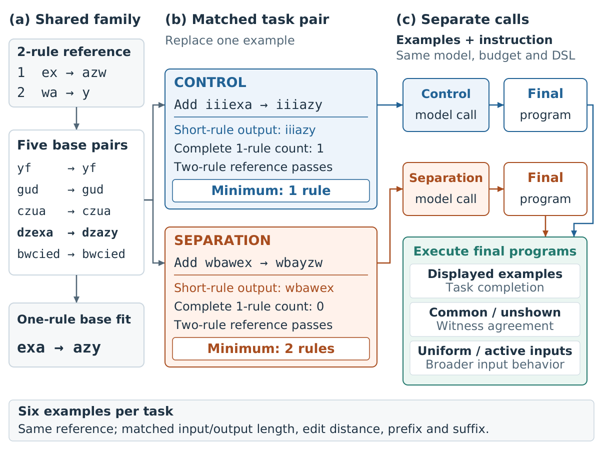

# When Is Program Structure Required? Certificate-Grounded Calibration of Program-Induction Difficulty

Wenzhang Du · Independent Researcher, China · arXiv preprint, November 2026

[Paper · arXiv:2611.24975](https://arxiv.org/abs/2611.24975) · [Technical report](https://dqswordman.github.io/technical-reports/program-structure-certificates/) · [中文伴读](https://dqswordman.github.io/zh/technical-reports/program-structure-certificates/) · [Interactive Space](https://huggingface.co/spaces/DQSWORDMAN/program-structure-certificates)

Six demonstrations can be consistent with either a one-rule shortcut or a two-rule reference program. Change one example and test every legal single rule. This repository links that proof of minimum length to the programs two language models produced on the paired tasks and to their behavior on new strings.

[Reproduction guide](docs/reproduction.md) · [Result map](docs/result-map.csv) · [Data provenance](DATA_PROVENANCE.md) · [Frozen artifact v1.0.0](https://github.com/dqswordman/program-structure-certificates/tree/v1.0.0)

## Follow one archived task pair

From the repository root with Python 3.11 or newer:

    python -B verify_manifest.py
    python -B replay_fixture.py

The fixture checks the six-example pair in Figure 1. The control admits the single replacement from exa to azy. The separation example excludes that rule, and the shared two-rule reference satisfies both specifications. The command reports certified minima of **one** and **two**, then executes four saved Qwen and Olmo programs on the displayed, witness, uniform, and rule-active inputs. It uses the included archive and the Python standard library.

## Results at a glance

Across both models and the three-to-six base-example settings, the certified separation tasks reduce displayed-task completion by **23.53 to 45.83 percentage points** and increase exact success on the wholly unshown witness pair by **8.40 to 13.45 points**. Agreement on strings activating both reference rules ranges from **1.93% to 5.78%** in the separation conditions. The archived tables distinguish these evaluation targets. [Primary panel](results/PRIMARY_PANEL_READABLE.csv) · [Broader-input panel](results/BROADER_PANEL_READABLE.csv)

## Replay the panel

Create an environment with NumPy, then run the full CPU check from the frozen tag:

    python -m pip install -r requirements.txt
    python -B reproduce.py --out replay

This reads **1,920 saved outputs**, checks **960 certificates** and **7,680 additional reference labels**, and regenerates the three comparison CSVs. The result map marks which historical analyses are available as aggregate tables and protocols. [Full instructions](docs/reproduction.md) · [Verification report](docs/reproduction_report.json)

## Citation

Cite Wenzhang Du, *When Is Program Structure Required? Certificate-Grounded Calibration of Program-Induction Difficulty*, arXiv:2611.24975 (2026). The [public release](PUBLICATION.md) lists the software and data licenses, the frozen revision and the [single offline download](https://github.com/dqswordman/program-structure-certificates/releases/download/v1.0.0/program-structure-certificates-v1.0.0.zip). [CITATION.cff](CITATION.cff) · [Version record](docs/release-manifest.json)
