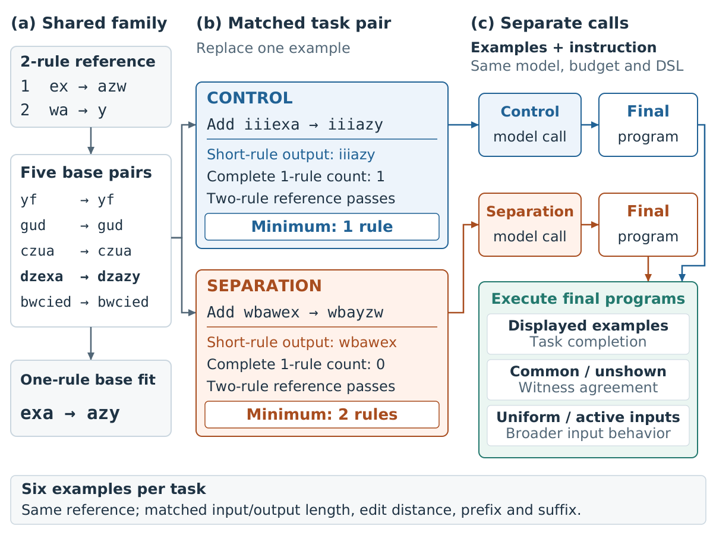

# When does an example force a second rule?

Wenzhang Du · arXiv:2611.24975v1 · v1.0.1 · 2026-11-22

Can a single string-replacement rule explain examples generated by two rules? Replacing one demonstration can rule out every legal one-rule solution. Across two models and the tested demonstration counts, this change lowers completion on the displayed tasks by 23.53–45.83 percentage points and raises success on a hidden distinguishing example by 8.40–13.45 points. Agreement on other strings remains much lower when both rules must act.

## One changed demonstration rules out the shortcut

A task shows six input–output pairs. Five stay fixed. In the control, the sixth maps iiiexa to iiiazy. Replacing exa with azy fits all six, but so does a longer program that first replaces ex with azw and then wa with y. The displayed outputs alone allow either explanation.

In the matched separation task the final pair becomes wbawex → wbayzw. The shortcut leaves wbawex unchanged. The two-step program produces wbawazw after its first rule and wbayzw after its second. All other demonstrations stay fixed. The figure traces both explanations on this archived task.



Figure 1. Read the last demonstration under each program. Both programs fit the control, but only the two-step reference produces wbayzw on the changed input. Enumeration checks every legal single rule.

## Why the minimum is exactly two

Here a rule replaces every non-overlapping occurrence of a literal string. Rules run in sequence. The study fixes a finite alphabet, a left-hand side of one to three characters and a right-hand side of up to three. A changed output rules out the empty program. The verifier enumerates the legal one-rule explanations and executes a two-rule witness.

One legal single rule fits the control and none fits its partner. A changed output also excludes the empty program. Because the reference executes successfully in both tasks, these checks fix the minimum lengths at one and two. The verifier uses only the displayed pairs, before either model sees them. Its guarantee is relative to the specified replacement language and rule lengths.

## Displayed completion falls as hidden-test success rises

Each of the 120 reference families supplies matched control and separation tasks with three to six shared examples, plus one arm-specific example. The panel contains 1,440 new trajectories and 480 previously saved base-five trajectories for Qwen3-8B and Olmo-3-7B-Think. The certified comparison uses 119 families at bases three and four and all 120 at bases five and six.

With five shared examples, Qwen satisfies all displayed pairs in 67 of 120 control tasks and 12 of their partners. Olmo’s counts are 52 and 15. Both models are more likely to pass a separate input–output pair omitted from both prompts. The table pairs tasks by reference family. Differences are in percentage points, with pointwise 95% intervals.

| Model | Displayed, control → separation | Displayed Δ (pp) | Hidden pair Δ (pp) |
| --- | --- | --- | --- |
| Qwen3-8B | 67 → 12 / 120 | −45.83 [−55.00, −36.67] | +9.17 [+4.17, +15.00] |
| Olmo-3-7B-Think | 52 → 15 / 120 | −30.83 [−40.83, −20.83] | +11.67 [+6.67, +17.50] |

Five shared demonstrations and one changed demonstration, with 120 matched families per model. Δ is separation minus control. Across all eight settings, displayed completion falls by 23.53–45.83 points while hidden-test success rises by 8.40–13.45 points.

## How often do programs agree on new inputs?

The hidden pair was chosen to distinguish programs. A second evaluation draws 32 uniform strings and 32 strings that activate both reference rules for each family. Uniform-input agreement falls in every model and base-count setting. Of the 3,840 uniform inputs, 3,325 map to themselves under the reference.

On strings that activate both reference rules, programs returned for the separation task agree with the reference on only 1.93–5.78% of inputs across settings. With five shared examples, agreement is 2.76% for Qwen and 2.01% for Olmo. Passing one test chosen to expose a shortcut leaves substantial uncertainty about what the program does on other strings.

## An unchanged string can still decide the minimum

In another family, the reference replaces f with fdd and then db with c. The displayed string iyxbdc stays unchanged. The candidate rule b → dc would return iyxdcdc, so this apparently uneventful example excludes it. Removing the example at the smaller demonstration counts restores a one-rule solution. The family was selected from this change in its certificate before examining model outcomes.

## Run the certificate check and reconstruct the three tables

Extract the release, enter its top-level folder and run the first two commands with Python 3.11 or later. The third uses NumPy and writes to a new directory. It verifies 960 certificates, 7,680 reference labels and the saved programs, then compares the three reconstructed tables with their archived counterparts.

The 120-family experiment can be replayed from the released task specifications and saved trajectories. The result map separately lists the earlier discovery and timed-search studies. For the retrospective list of 1,008 tasks, the historical sampling and filtering steps remain unresolved, which limits what that list can establish about task frequencies.

```sh
python -B verify_manifest.py
python -B replay_fixture.py
python -B reproduce.py --out replay
```

## Sources

- [Paper and version history · arXiv](https://arxiv.org/abs/2611.24975)
- [Version 1 with appendix · HTML](https://arxiv.org/html/2611.24975v1)
- [Figure 1 executable fixture](https://github.com/dqswordman/program-structure-certificates/blob/v1.0.0/fixtures/end_to_end.json)
- [Primary and witness effects](https://github.com/dqswordman/program-structure-certificates/blob/v1.0.0/results/PRIMARY_PANEL_READABLE.csv)
- [Uniform and active input panel](https://github.com/dqswordman/program-structure-certificates/blob/v1.0.0/results/BROADER_PANEL_READABLE.csv)
- [Identity-example certificate](https://github.com/dqswordman/program-structure-certificates/blob/v1.0.0/worked_case.json)
- [Paper-to-artifact result map](https://github.com/dqswordman/program-structure-certificates/blob/v1.0.0/docs/result-map.csv)
- [Interactive certificate explorer](https://huggingface.co/spaces/DQSWORDMAN/program-structure-certificates)
