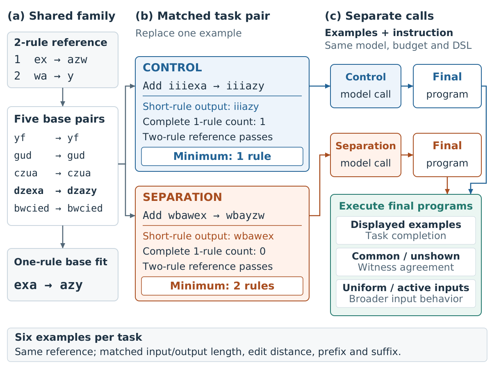

# 什么样的样例会迫使程序使用第二条规则？

Wenzhang Du · arXiv:2611.24975v1 · v1.0.1 · 2026-11-22

两条规则生成的字符串样例，是否非得用两条规则才能解释？替换一个展示样例，就能排除所有合法的单规则解。在两种模型和各个展示规模下，这一变化使完成题面的比例降低 23.53–45.83 个百分点，却使通过隐藏辨别样例的比例提高 8.40–13.45 个百分点。换到确实触发两条规则的其他字符串上，模型仍很少复现参考程序的输出。

## 只换一个样例，单规则捷径便失效

一道题给出六对输入输出，其中五对保持不变。对照题的第六对是 iiiexa → iiiazy。把 exa 换成 azy 就能解释全部六对。先把 ex 换成 azw、再把 wa 换成 y，也能解释它们。仅凭这组展示结果，两种解释都成立。

在配对的分离题中，把最后一组换成 wbawex → wbayzw。单规则捷径会原样保留输入；两步程序先得到 wbawazw，再得到 wbayzw。其余五组样例全部相同。下图给出了这对归档任务的完整构造。



图 1。分别用两个程序处理最后一个展示样例。两者都符合对照题，换题后只有两步参考程序能在该输入上产生 wbayzw。穷举检查涵盖所有合法的单条规则。

## 怎样证明最短解恰好需要两条规则

每条规则替换字符串中所有互不重叠的字面匹配，多条规则按顺序执行。研究固定有限字母表，左侧长度为一至三个字符，右侧长度最多三个字符。一组发生变化的输出即可排除空程序。验证器随后枚举全部合法单规则解释，并实际执行一个双规则解。

对照题有一条合法单规则解。在与它配对的另一道题上，单规则解为零。至少有一个输出发生变化，也排除了空程序。两步参考程序在两道题上都能执行并通过，因此最短解分别为一条和两条规则。核验发生在模型看到题目之前，只用展示样例。这个保证限于预先规定的替换语言及规则长度。

## 题面完成率下降，隐藏样例通过率上升

120 个参考程序家族在三至六个共享样例下各生成一对任务，并各加一个对照或分离样例。两种模型为 Qwen3-8B 和 Olmo-3-7B-Think，共有 1,440 条新轨迹和 480 条先前保存的五共享样例轨迹。三个、四个共享样例时各有 119 个家族通过配对认证，五个、六个时各有 120 个。

固定五个共享样例时，Qwen 在 120 道对照题中完成 67 道，在对应的双规则必需题中完成 12 道。Olmo 分别完成 52 道和 15 道。两种模型在另外一对从未展示的输入输出上，通过率反而提高。表中按参考程序家族配对，差值用百分点表示，并列出各项的 95% 区间。

| 模型 | 题面，对照 → 分离 | 题面差值（百分点） | 隐藏配对差值（百分点） |
| --- | --- | --- | --- |
| Qwen3-8B | 67 → 12 / 120 | −45.83 [−55.00, −36.67] | +9.17 [+4.17, +15.00] |
| Olmo-3-7B-Think | 52 → 15 / 120 | −30.83 [−40.83, −20.83] | +11.67 [+6.67, +17.50] |

每个模型均有 120 个配对家族。这一行设定为五个共享样例加一个改变的样例，Δ 是双规则必需题减对照题。在全部八个设置中，题面完成率下降 23.53–45.83 个百分点，隐藏样例通过率上升 8.40–13.45 个百分点。

## 换一批新输入，模型与参考程序的输出有多大比例一致？

隐藏见证配对是为区分程序而选择的。第二组评估则为每个家族抽取 32 个均匀输入和 32 个能触发两条规则的输入。在全部模型和共享样例数设置下，均匀输入上的一致率都下降。3,840 个均匀输入中，有 3,325 个经过参考程序后保持原样。

在同时触发两条参考规则的字符串上，各设置中双规则必需题所得程序与参考程序的输出一致率只有 1.93%–5.78%。固定五个共享样例时，Qwen 为 2.76%，Olmo 为 2.01%。即使通过专门用来识别捷径的一道测试，仍很难据此推断程序在其他字符串上会做什么。

## 输出原样返回，也可能决定最少需要几条规则

另一组任务的参考程序先将 f 换成 fdd，再将 db 换成 c。输入 iyxbdc 时输出原样返回，但候选单规则 b → dc 会给出 iyxdcdc。因此，恰是这个“什么也没变”的样例排除了该候选。在较少展示样例的设置里，删掉它便重新出现单规则解。选取这个家族的依据是证书的变化，选例时尚未查看模型表现。

## 核验证书并重建三张结果表

解压版本包并进入顶层目录。用 Python 3.11 或更新版本运行前两条命令即可核对文件和图 1 实例。第三条使用 NumPy，将结果写入新目录；它复核 960 份证书、7,680 个参考标签与保存的程序，并把三张重建结果表逐一对照归档。

120 个家族的配对实验可用已发布的任务说明和模型轨迹回放。早期发现性分析和限时搜索实验另列在结果索引中。对回顾性的 1,008 项任务，历史抽样和筛选过程尚未厘清，因此无法据此可靠估计各类任务的出现频率。

```sh
python -B verify_manifest.py
python -B replay_fixture.py
python -B reproduce.py --out replay
```

## 资料来源

- [预印本与版本记录 · arXiv](https://arxiv.org/abs/2611.24975)
- [v1 全文与附录 · HTML](https://arxiv.org/html/2611.24975v1)
- [图 1 可执行实例](https://github.com/dqswordman/program-structure-certificates/blob/v1.0.0/fixtures/end_to_end.json)
- [主面板与隐藏配对结果](https://github.com/dqswordman/program-structure-certificates/blob/v1.0.0/results/PRIMARY_PANEL_READABLE.csv)
- [均匀与规则激活输入结果](https://github.com/dqswordman/program-structure-certificates/blob/v1.0.0/results/BROADER_PANEL_READABLE.csv)
- [恒等样例证书](https://github.com/dqswordman/program-structure-certificates/blob/v1.0.0/worked_case.json)
- [论文至归档的结果映射](https://github.com/dqswordman/program-structure-certificates/blob/v1.0.0/docs/result-map.csv)
- [交互式证书示例](https://huggingface.co/spaces/DQSWORDMAN/program-structure-certificates)
